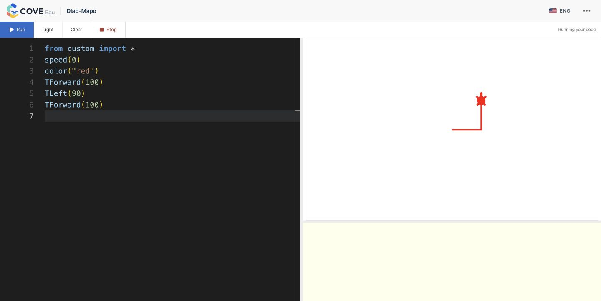

# Production performance after v2.0.43

Date: 2026-10-27 (Asia/Seoul)
Status: representative production verification; no application or infrastructure changes made during this audit.
Deployment: `v2.0.43`, source `af8c54aedfcc69adac07dd3e0435b3827a1a5c27`.

## Result

Staff course/class navigation was faster in this small before/after comparison.
Student navigation still took roughly 1.4–1.6 seconds, public Turtle took roughly
3.8–4.3 seconds to show the fast test drawing, and the two-example Test run action
took 4.3–11.4 seconds. The deployment has not established that all performance
targets are met. An official submission/grade-save benchmark was not performed.

## Scope and method

Signed in normally with all five supplied role accounts. Checked Courses and
Classes/My classes three times per role, a large course outline, the teacher
analytics heading, a student exercise workspace and its public sample checks,
and public Turtle using the supplied classroom code. This does not cover every
route or workflow, concurrent classrooms, video playback, uploads or official
submission persistence.

Navigation timers ran from UI click to the destination heading and first data
row/card. They include browser-control overhead. Assets warmed naturally; no
standardized network/device, cache eviction, randomized A/B test or load test was
used. Three observations cannot establish p95 or capacity. Historical samples
come from the [pre-release investigation](2026-10-27-production-page-navigation-performance.md).
Role/account labels are anonymized in the retained evidence; credentials,
classroom code, student source/output, roster data and identifiers are omitted.

## Navigation

Medians, seconds; each list has three observations:

| Role | Courses before → after | Classes/My classes before → after |
| --- | --- | --- |
| Manager | 1.501 → 0.809 (46% lower) | 1.365 → 0.871 (36% lower) |
| Platform administrator | 1.247 → 0.772 (38% lower) | 0.785 → 0.643 (18% lower) |
| Teacher | 2.123 → 1.055 (50% lower) | 1.460 → 1.002 (31% lower) |
| Team lead | No baseline → 0.940 | No baseline → 0.717 |
| Student | No baseline → 1.461 | No baseline → 1.420 |

All five sign-ins and the measured list navigations completed. No error page
was observed on these paths. The teacher Courses samples included a 2.189-second
outlier. Student lists remained 1.171–1.650 seconds across both surfaces.

The 427-material course heading first appeared at 3.086 seconds. Two later visits
with a stricter heading-plus-first-material-link boundary took 1.587 and 1.762
seconds. These different boundaries must not be combined into one distribution.
The historical 3.70-second large-course measurement was a network request, not
UI readiness, so it does not support a precise before/after UI percentage.
Teacher analytics heading-only readiness was 1.883 seconds.

The student workspace opened after choosing its class context. A browser-control
wait exceeded its deadline even though subsequent diagnostics and inspection
showed the editor visible; no reliable initial editor duration was retained.
That observation is not evidence of a measured application timeout.

## Public Turtle

Used seven sequential synthetic runs, without bursts or concurrent load. The
timed visual probe was a small red L using `speed(0)`. After observing a fresh
blank frame, screenshots were decoded and checked for more than 300 red pixels
in the drawing pane, excluding the editor and Stop control. Run-to-drawing
observations were **3.810, 3.777 and 4.307 seconds**. They include prior run
teardown, request/runtime/viewer startup, screenshot polling and JPEG decoding.
They are approximate user-visible timings, not precise runtime CPU timings.

Two separate Run-to-viewer-Ready observations were 3.756 and 3.632 seconds. A
Ready viewer initially showed a blank canvas, so that signal alone is insufficient
to certify a visible drawing. An initial 3.236-second canvas-availability probe
could not read pixels through the browser tool; it is excluded from drawing
timings.

The helper defaults to `speed(1)` with a 25 ms screen delay. The same L with
explicit `speed(1)` took 4.963 seconds to pass the first-red threshold and 6.760
seconds to pass a near-complete threshold of 700 pixels. This measures the small
test L, not the entire original starter program. `speed(0)` reduces animation
delay but does not remove runtime/viewer startup.

There is no comparable pre-release production drawing baseline. Turtle worked,
but this audit cannot claim that the release made it faster. The public broker
is independently deployed; no warm-pool setting or execution limit was changed.

## Student Test run and server timing

Used the existing student draft unchanged. Test run checks two public examples
sequentially. Three timed actions completed in **5.299, 4.324 and 11.406 seconds**.
An initial setup action was untimed. Each result was an ordinary sample-output
mismatch; no infrastructure fault was recorded. This validates completion and
measures waiting, not correctness of the student's solution.

Read the eight corresponding recent ephemeral records using Redis SCAN/GET;
account lookup ran in an explicitly read-only database transaction. No source,
input, expected/actual output, tokens or record/user identifiers were retained.
All eight records were COMPLETED with no infrastructure failure. Per-example
queue times were **5–354 ms**. Execution-engine wall time ranged from **133 ms
to 4,686 ms**; this includes waiting for an interpreter, transport and retirement,
not only Python execution. Comparison took 1–12 ms.

For the slowest action, the two accepted-to-finished server lifecycles totaled
6.144 seconds. Approximately 5.262 seconds of the UI interval lay outside those
lifecycles. Admission/authentication, sequential requests, result polling,
network/rendering and measurement overhead can contribute. This audit does not
isolate those components and does not attribute that remainder solely to polling.

A later read-only sandbox health snapshot showed:

- Capacity two, one spare, three idle interpreters, no waiting/warming work at
  the snapshot; the four inspected queues also had no active/waiting jobs at
  their snapshot. These are not continuous-load measurements.
- A 1.5-CPU sandbox quota, memory peak approximately 403 MiB of its 1,280 MiB
  limit, and zero OOM/OOM-kill events.
- Cumulative CPU throttling: 385 of 15,581 periods and 58.94 throttled seconds.
  Without a before/after interval, this does not quantify throttling during a
  particular test or prove host CPU exhaustion.
- Eight interpreter-acquisition observations totaling 5.150 seconds: six were
  at most 10 ms, one was 0.5–1 second, and one was 4–8 seconds. Eleven preparation
  observations totaled 107.778 seconds, including initial/background warmup.
  Preparation can overlap other work; do not add its total to browser timings.
- No recorded prepare failures, output-drain fallback or forced termination.

The acquisition outlier is consistent with intermittent waiting for a prepared
interpreter. These aggregate histograms have no per-request correlation, so they
cannot prove which sample experienced that wait. A trace across admission,
engine acquisition and response delivery is the next useful measurement.

## Next priorities and limits

1. Trace the complete two-example Test run, including admission/authentication,
   sequential request delivery, polling and per-request interpreter acquisition.
   Reduce the measured overhead while preserving cancellation and isolation.
2. Investigate prepared-interpreter replenishment under the existing CPU quota.
   Benchmark quota/runtime alternatives in an isolated environment before
   changing production capacity. Current evidence does not justify declaring
   VPS 6 insufficient or promising that a larger VPS will solve the delays.
3. Profile student list requests and first large-course rendering; those still
   have visible waits despite the staff-list improvement.
4. Measure public Turtle startup separately from drawing animation, then verify
   any warm-start change with its isolation, memory and capacity constraints.

No official Submit was clicked; grades, points and saved exercise code were not
changed. Normal authentication/activity events and temporary sample-check/run
records occurred. The student account was signed out; the synthetic Turtle
execution was cleared and exited, and both audit tabs were closed. No production
pause, restart, CPU change or load benchmark occurred during this verification.

## Evidence

- [Browser observations](assets/2026-10-27-post-release-performance/browser-observations.json)
- [Sample-check lifecycle timings](assets/2026-10-27-post-release-performance/sample-check-timings.json)
- [Sandbox aggregate diagnostics](assets/2026-10-27-post-release-performance/sandbox-diagnostics.json)
- [Release deployment](https://github.com/dlabmapo-web/codebuddy-platform/actions/runs/40452583757)
