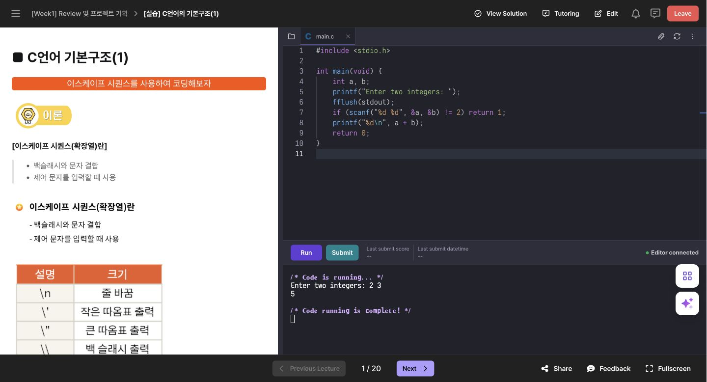
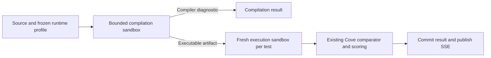

# Elice C/C++ research and recommended Cove implementation — 2026-11-09

This is a research report and proposed implementation direction. No runtime implementation or deployment was performed.

## Recommendation

Add native GCC-based C and C++ support alongside Cove's existing Python execution. Reuse Cove's grading rules, weighted scores, submission history, queues and SSE feedback. Extend the existing NsJail infrastructure with distinct compiler and executable-runner profiles, and add a server-backed interactive Run session.

The essential change is a **compile-once stage before case execution**. Running a compiler inside today's per-case `ExecutionEngine.run()` would rebuild the same program for every test and waste classroom capacity.

Use Elice's currently available C courses and shared C/C++ environment as the reference, following the user's clarification. A separate C++ course was not visible, so C++ behavior below is a recommendation supported by compiler documentation, not a claimed Elice C++ execution test.

## What was inspected in Elice

Visited the user's [teaching course library](https://dlab.elice.io/my-courses/library/teach?tab=all) and both pages of its six entries. It contains:

- [C Advanced: DC-C-2](https://dlab.elice.io/courses/24518/lectures/all).
- C Basic: DC-C-1, course `793625`.
- Python, JavaScript and two other web courses.

There was no separately named C++ course among those six entries. The separate enrolled Course view contained zero courses.

Inspected [C Advanced's first exercise](https://dlab.elice.io/courses/24518/lectures/191641/lecturepages/2075267), its learner workspace, and its [authoring screen](https://dlab.elice.io/courses/24518/lectures/191641/lecturepages/2075267/edit).

| Area | Verified observation |
| --- | --- |
| Editor | A `main.c` file in a browser code editor. |
| Run | Separate Run and Submit controls. Run becomes Stop while the process is active. A remaining-time countdown is displayed. |
| Interactive input | A temporary original C program printed a prompt, waited in `scanf`, accepted `2 3` through the terminal, and printed `5`. |
| Compilation failure | Running the initial empty file produced a linker diagnostic for missing `main`, followed by a missing-executable message from the Run script. |
| Run command | The authoring UI and `.elice/runner.sh` both showed `gcc main.c -o main` followed by `./main`. |
| Environment | Env Settings identifies the environment as **C / C++**. The inspected exercise has an overall 91-second limit and a 512 MB memory limit. These are that exercise's settings, not established platform defaults. |
| Grading | The exercise uses a Standard Input/Output grader. Its visible configuration points to input/output text files, a weighted `stdout` check, and a case time limit. |
| Grader entry | `.elice/grader.sh` invokes the platform's Python autograder; C execution and output comparison are separate concerns. |
| Curriculum | The C Advanced outline includes pointers, arrays, dynamic memory allocation, structures/unions/enums, file I/O and projects. |

The linker diagnostic contains an `x86_64-linux-gnu/5` GCC path. That suggests an older GCC environment, but the exact compiler patch, system image, language standard and all execution flags were not verified. The visible Run script specifies no `-std` or optimization option. Elice's UI does not establish its server isolation architecture; no claim is made that Elice uses NsJail.

Only Run was used. No graded answer was submitted, no authoring changes were saved, and the original blank learner draft was restored after the input/output test.

### Evidence



Additional captures: [compile failure](assets/2026-11-09-c-cpp-runtime/c-compile-error.jpg), [Run script and STDIO grader](assets/2026-11-09-c-cpp-runtime/c-run-script.jpg), [environment and limits](assets/2026-11-09-c-cpp-runtime/c-environment.jpg).

## Cove's current capabilities and gaps

These findings come from the current local checkout, not a new inspection of production hosts.

| Layer | Current evidence | Needed change |
| --- | --- | --- |
| Language contract | `packages/shared/src/content/course.ts` and Prisma `ExerciseLanguage` accept only `PYTHON`. | Add `C` and `CPP`, with explicit runtime profiles rather than guessing from source. |
| Authoring/import | Course creation/import paths contain Python defaults; starter and solution editors use Python syntax mode. | Add language selection, appropriate starter source and filenames; retain the language through import, export and copying. |
| Learner Run | `use-python-runner.ts` uses the browser Pyodide `InteractiveRunner`; the workspace calls it directly. | Introduce a language-neutral runner adapter; preserve Python's existing path and use remote sessions for C/C++. |
| Case execution | `ExecutionRequest` has source and stdin, but no compilation lifecycle. `grading.service.ts` and `case-evaluator.ts` invoke it per test case. | Prepare a compiled program once, then run its artifact in a fresh case environment. |
| Native runtime | `packages/grading-runtime` provides NsJail isolation, cgroup accounting, cancellation, bounded output and immutable identities. Its descriptors, rootfs, bootstrap and policies are CPython-specific. | Add a versioned compiled-language runtime family; the Python jail is not a generic C/C++ runner. |
| Admission/routing | Native admission may return null to select the existing Python compatibility route. Queue names and runtime-version handling assume `native-cpython`. | Route by frozen language/profile identity; unavailable C/C++ capacity must never fall through to Pyodide. |
| Verdicts | Current schemas have wrong output, runtime error, time and memory limits, but no explicit compilation result. | Add typed compilation diagnostics and phase feedback without treating a compiler error as a judge outage. |
| Grading semantics | Cove already has STDIO comparators, weights, hidden cases, progress and immutable submission policies. | Reuse them for native program stdout, preserving their existing behavior. |

The latest runtime/deployment documentation describes native CPython grading and bounded qualification evidence. The package README also retains historical candidate caveats. Neither establishes that a future C/C++ image is qualified, or that a particular classroom size will fit. Its compiler and executable profiles need their own checks and measurements.

## Options considered

| Approach | Benefit | Cost and fit |
| --- | --- | --- |
| **Extend Cove's native infrastructure — recommended** | Keeps one grading system and its existing semantics; supports the real terminal behavior observed in Elice. | Requires compiler isolation, artifact ownership, remote interactive sessions and Linux qualification. Best fit for the existing architecture. |
| Judge0 behind an adapter | Its documented API already supports sandboxed compilation/execution, compilation diagnostics, stdin, limits, callbacks and multiple languages. | Adds a runtime service and operational model. Its ordinary submission API accepts stdin in advance; it does not by itself supply the classroom's live interactive terminal. Keep Cove's comparison/scoring if using it. |
| Browser WebAssembly toolchain | Could reduce server execution for some practice programs. | Requires shipping a browser compiler/toolchain and adapting filesystem and terminal behavior. Emscripten's documentation describes portability constraints. Browser timing and client-side results should not determine official grades. Consider later as an optional practice feature. |

Sources: [Judge0 API](https://ce.judge0.com/), [Emscripten portability guidelines](https://emscripten.org/docs/porting/guidelines/portability_guidelines.html), [NsJail](https://nsjail.dev/).

## Recommended execution model



### 1. Versioned language profiles

Start with **C17** and **C++17**, a pinned GCC toolchain and an explicit architecture. Use `main.c` and `main.cpp`. GCC documents selecting standards with `-std`; use `g++` for C++ so its standard library is linked automatically. Do not depend on a compiler's changing default dialect.

Illustrative trusted compiler argument lists:

```text
gcc -std=c17 -O0 -Wall -Wextra /src/main.c -o /out/program -lm
g++ -std=c++17 -O0 -Wall -Wextra /src/main.cpp -o /out/program
```

These are proposed teaching profiles, not Elice's observed commands. `-O0` follows the absence of optimization in the inspected Run script; an algorithm profile could explicitly use `-O2`. Warnings should be shown without becoming errors by default. If imported content needs GNU extensions or an older dialect, introduce a named, tested compatibility profile rather than silently changing all exercises.

Freeze compiler version, standard, flags, target architecture, libc/libstdc++ identities, image/rootfs digest, sandbox policies and comparator version with the submission. Existing Python snapshots must continue to parse and replay unchanged. Initially, keep one profile per exercise rather than adding per-submission language switching and multiple starter variants.

References: [GCC standards](https://gcc.gnu.org/onlinedocs/gcc/Standards.html), [dialect options](https://gcc.gnu.org/onlinedocs/gcc/C-Dialect-Options.html), [compiling C++](https://gcc.gnu.org/onlinedocs/gcc/Invoking-G_002b_002b.html).

### 2. Compilation before case execution

Add a preparation lifecycle at the grading-job level, for example prepare → run cases → dispose. The names are illustrative; the boundary is what matters. The preparation result belongs to one attempt and cannot be shared through mutable engine-global state across concurrent submissions.

- Compile exactly once for an attempt; execute its artifact separately for every case that the existing continuation rules require.
- Run the compiler in a separate constrained environment. Compiling is also processing untrusted source; compiler time, memory, process count, scratch and diagnostic output need finite limits.
- Keep compilation time separate from each program's authored execution budget. Show queueing, compiling and running as different phases. Overall job deadlines must cover those phases explicitly.
- A provisional compilation envelope could be 10 seconds, 512 MiB and bounded scratch/output, then be adjusted from the real C/C++ corpus. These are unmeasured starting values, not a capacity promise.
- Use fixed executable/argument arrays controlled by the runtime. Do not run imported `runner.sh` files or arbitrary compiler flags in trusted services.
- Treat produced binaries as untrusted. Transfer only an attempt-owned, size-bounded regular artifact through a trusted lifecycle, with path/symlink/race checks. Bind it read-only at an executable location for case execution; preserve `noexec` scratch elsewhere.
- Create a fresh process, filesystem scratch and resource accounting for every case. The compiler and hidden expected outputs are absent from the executable's environment.
- Preserve cleanup and reservations across cancellation, disconnect and worker crashes. A compiler crash is an infrastructure fault; invalid learner source is a compilation result.

The current CPython policy denies process creation and has Python-specific executable mounts. A GCC driver needs to invoke compiler/assembler/linker subprocesses, and native executable loading has different requirements. Use distinct narrowly bounded compile/run policies, not a blanket relaxation of the Python policy.

### 3. Two user actions: Run and Submit

**Run** should compile the current draft and create an authenticated ephemeral session that streams output and accepts stdin. Reuse the terminal transcript and monitoring event model through an adapter. A WebSocket gateway can carry input, output, resize and Stop while a dedicated runner owns the process. Bind sessions to the authenticated user, academy and exercise; enforce message/output limits, idle expiry, absolute duration and disconnect cleanup.

Match the observed Elice behavior: a running indicator, Stop, a countdown, interactive `scanf`/`cin`, multiline paste and EOF. A PTY provides terminal semantics for interactive programs; qualify its buffering, echo, line endings and EOF behavior. This is a new native interactive sandbox profile, not functionality already provided by the current final-response Unix-socket engine. Batch grading should use pipes and exact test stdin instead of a PTY, so terminal echo and newline conversion cannot contaminate stdout comparison.

**Submit** should freeze code and the trusted runtime profile, enqueue official work, compile once and run the ordinary cases. Retain the existing SSE result delivery. Public sample checks, staff practice, regrades and solution verification must resolve the same language profile, wherever those features exist.

No learner code runs inside Next.js or the NestJS request-serving process. Keep Run/compiler capacity bounded and reserve official grading capacity so repeated Run clicks do not delay a classroom's submissions.

PTY reference: [Linux pseudoterminal documentation](https://man7.org/linux/man-pages/man7/pty.7.html).

### 4. Compilation and execution feedback

Represent compilation as an attempt-level typed result, with bounded diagnostics and source positions where available. A suggested mapping keeps the existing top-level `FAILED` submission status plus an explicit compilation-failure reason and unrun cases; it does not invent one runtime error per test. The final contract needs a design decision before implementation.

Show clear distinctions between compilation error, wrong output, runtime crash, time limit, memory limit and service failure. Compiler resource-limit termination should also be distinguishable from unavailable infrastructure. Report native exit/signal information only after mapping it to a safe typed result. Do not label every segmentation fault as an out-of-memory event.

Use Monaco language modes for C/C++, source filenames in diagnostics, and the same language in starter, official solution, history and teacher views. Keep raw bounded diagnostics available alongside any translated explanation. A separate clangd/LSP service is optional later; syntax highlighting and compilation diagnostics are enough for the first release.

### 5. File I/O and compatibility

The advanced course teaches file I/O, so single-file STDIO support alone does not establish complete course compatibility. Stage file exercises and projects separately:

- Support authored input assets and a bounded writable working directory, fresh for each run/case.
- Define whether produced files are for download, display or grading. Existing stdout comparators cannot grade an output file by themselves.
- Add multiple source/header files only with an explicit file manifest and trusted build rules.
- Audit lessons for removed functions, implicit declarations, platform-specific headers/commands, pointer-address expectations and undefined behavior. Old GCC acceptance is not a reason to promise identical behavior under a modern compiler.
- Keep hidden expected outputs and grading scripts outside the learner filesystem. Never execute a downloaded course's shell or grader scripts as host orchestration.

## Suggested delivery order

1. **Native compile/run foundation:** versioned C/C++ profiles, compile-once lifecycle, fresh execution, language-aware routing and compilation results. Qualify it on disposable Linux infrastructure.
2. **STDIO classroom support:** authoring language selection, source defaults, matching Run/Submit, diagnostics, sample checks, history and teacher feedback. Pilot representative C exercises and original C++ smoke exercises.
3. **Advanced course coverage:** assets, file I/O, multiple files and projects based on the actual imported content. Certify compatibility per runtime profile and exercise revision.
4. **Classroom sizing:** measure simultaneous compilation, interactive sessions and submissions together; tune queues, reservations and capacity from those results.

A standalone prototype can establish compiler behavior, but the first user-facing release should include both Run and Submit for the supported exercise subset. Offering C in the editor while Run still assumes Python would leave an incomplete classroom flow.

## Required checks and performance constraints

- C: printing, integer/floating input, multiline paste, EOF, arrays, pointers, `malloc/free`, Unicode output and math-library linking.
- C++: `cin/cout`, strings, vectors/maps, templates, exceptions and the selected standard library.
- Syntax/link failures, compiler limits, runtime crashes, runaway output, loops, memory exhaustion, cancellation, disconnect and fresh-case isolation.
- Confirm one compilation for ten test cases, with no stale executable after a failed build.
- Verify identical runtime profiles for Run, sample checks, Submit, staff practice and regrades. Test runtime-unavailable routing: C/C++ must not enter Python compatibility queues.
- Preserve current scoring, continuation, hidden-case disclosure, first-solve points and historical Python behavior.
- Run actual compiler and binary containment checks on the intended Linux environment; unit tests and Docker Desktop do not certify isolation or classroom capacity.
- Measure end-to-end latency under mixed load. Report queue wait, compile time, execution and comparison separately; do not reuse Python benchmark numbers for C++ compilation.
- Load all needed cases/profile data in a bounded set of reads. Do not query language settings inside the test loop, stream terminal chunks through SQL, or poll for animation/phase updates. Use existing request-scoped access and event channels.
- Count changed API/page read-path statements against disposable PostgreSQL via `COVE_INTEGRATION_DATABASE_URL`, as required by AGENTS.md, and record changed counts when committing implementation.

## Work completed in this research pass

Inspected the Elice library, learner Run flow, compiler failure, interactive C input/output, environment settings and grader configuration; reviewed the relevant Cove source and primary runtime documentation; saved this report and four reference screenshots. Restored the blank learner draft and verified it remained blank after reloading. No graded answer, saved course edit, dependency installation, application change, Cove database operation, live-host audit or deployment was performed. Application tests were not run because this pass only adds research artifacts.
