# Production native Python grading

Date: 2026-10-28, Asia/Seoul.
Status: proposed production design, written at the user's request after the live
grading investigation. Specification work is authorized; this document does not
enable a runtime, deploy services, change resource limits, pause production, or
authorize historical regrading. Review the written design before implementation.

## 1. Decision

Build a production native CPython execution service behind the existing grading
evaluator. Replace repeated WebAssembly interpreter preparation for eligible new
Python submissions, while retaining versioned Pyodide execution for submissions
that were accepted against it. Keep the trusted comparator, grading rules,
student progress, and points in the judge worker.

The execution service uses a dedicated rootless container runtime and a bounded
pool of fresh, single-use guests. Both CPython and compatibility Pyodide guests
share one execution budget and one scheduler. Do not start a second full pool
beside the current sandbox. A transition of the legacy execution adapter is part
of this project and must pass its own regression checks before native admission.

Student Submit already uses server-sent events (SSE). Preserve that path. Measure
admission and completion delivery independently; improve staff-practice result
delivery after the execution path is correct. Public Turtle's Brython runtime,
course GUI/Turtle execution, browser Python Run, and general page navigation are
outside this change.

## 2. Evidence and its limits

The [sanitized live evidence](../../research/assets/2026-10-28-grading-latency/live-summary.json)
records production v2.0.46 / `0ae56bc6`, seven sequential staff-practice
submissions, and 33 passing cases. Staff practice shares the evaluator with
official grading but has a separate queue and result sink. Student grades,
progress, points, and production configuration were unchanged.

| Cases per submission | Server runs | Recorded `gradedAt - createdAt` | Continuously observed click-to-result |
| --- | ---: | --- | --- |
| 1 | 3 | 0.498–0.879 s | 2.848–2.902 s, 2 observations |
| 5 | 2 | 8.604–8.614 s | 9.724 s, 1 observation |
| 10 | 2 | 25.340–29.590 s | 27.691–32.727 s, 2 observations |

The ten-case windows contained exactly ten additional sandbox executions each:

| Window | Interpreter acquisition wait | Engine execution | Recorded queue wait |
| --- | ---: | ---: | ---: |
| First ten-case submission | 27.717 s | 1.341 s | 0.107 s |
| Repeat ten-case submission | 23.890 s | 0.949 s | 0.111 s |

Acquisition accounts for approximately 94% of those recorded server intervals.
The execution pool had capacity two, one spare, and a 1.5-CPU / 1,280-MiB
container limit. All observed queues were empty afterward; no preparation,
cleanup, or OOM failure was recorded. This establishes a production bottleneck,
not classroom capacity or a production percentile.

Important measurement corrections:

- `gradedAt` is assigned before the database write finishes. Earlier chat labels
  describing this interval as time to a saved grade were approximate. Acceptance
  testing must observe successful transaction completion, not infer it from this
  field. Preserve the recorded values rather than rewriting the evidence.
- Browser observations include automation and sampling overhead. The missing
  continuous browser observations are not reconstructed from later screenshots.
- Displayed `runtimeMs` is the slowest case, not the submission's elapsed time.
- Background preparation overlaps acquisition/execution. Do not add preparation
  durations to foreground durations to manufacture an end-to-end total.

The [native prototype report](../../research/2026-10-27-native-grading-prototype-verification.md)
found a ten-case median of 2.626 s against 12.397 s for its older Pyodide
baseline. Those were local ARM64 Linux containers under Docker Desktop, three
runs per sequential cohort, excluding application admission, queueing, and grade
persistence. The simultaneous native maximum exceeded five seconds. Its fixed
per-guest CPU quotas, memory accounting, and uncharged daemon overhead are not a
production configuration or a fair substitute for the complete acceptance test.

Elice's inspected exercise used `python3 -u main.py` under Ubuntu and one STDIO
check. Its [official example](https://help.elice.io/help/docs/elicelxp/for-admin/material/exercise/grading/script/python/case1.-.)
runs a runner for each case and reports a final score. Its private scheduling,
pooling, isolation implementation, and like-for-like submission latency were not
verified. This design targets Cove's measured bottleneck; it does not claim to
copy Elice's private architecture or guarantee identical latency.

## 3. Alternatives

| Approach | Benefit | Limitation / decision |
| --- | --- | --- |
| Production native CPython service | Directly targets the measured acquisition cost; supported by the local feasibility result | Selected, subject to compatibility, containment, resource, and performance gates |
| Retain Pyodide and tune CPU/concurrency | Smaller deployment change; might reduce replenishment latency | Keep as a measured fallback; four workers still share CPU and do not remove interpreter initialization |
| Buy a larger or dedicated execution host immediately | Could add throughput and resource separation | No purchase selected; first establish the candidate's actual budget and performance |

Reusing a guest after it has run student code, removing isolation, reducing test
coverage, changing scoring, increasing student deadlines, and accepting output
before exit/cleanup are not permitted latency optimizations. Fresh guests can be
prepared in advance; used student interpreters cannot be recycled.

## 4. Scope and success

Support automatic Python `LEGACY_STDIO` and `ELICE_STDIO` grading, staff practice,
server-checked samples, and explicit maintenance regrades through the same
runtime selection contract. Quizzes, manual review, and other non-execution
material paths continue to bypass the execution service.

The first native pilot is limited to certified standard-library exercises with
32–256 MiB learner budgets. Certification covers each material's grading
revision and package/runtime profile. Production support must cover the complete
configured case count, 100–60,000 ms case limits, prompt policies, and existing
shared input/output limits for that profile; do not retain the prototype's
three-second, small-output, or synthetic-only restrictions.

Exercises outside the certified native profile remain Pyodide at admission.
This is an explicit migration boundary, not a claim that every course has
already moved. Extending certification to larger memory/package profiles needs
the same compatibility and resource gates, without silently lowering an
exercise's allowance. Completion of this project requires publishing the
remaining Pyodide coverage and reasons; partial pilot coverage is not global
performance acceptance.

Retain the [existing performance targets](2026-10-27-platform-runtime-performance-design.md):

| Scenario | Acceptance target |
| --- | --- |
| Submit pending feedback | Visible within 100 ms; one accepted attempt per action |
| Simple unqueued one-case grading | Accepted-to-acknowledged-commit p50 ≤0.75 s, p95 ≤1.5 s |
| Simple unqueued five-case grading | Same boundary: p50 ≤2 s, p95 ≤3 s |
| Simple unqueued ten-case grading | Same boundary: p50 ≤3 s, p95 ≤5 s; p95 at least 50% below paired baseline |
| Commit-to-visible result | p95 ≤1.5 s in a visible tab; publish separately from grading |
| Mixed load | Reference API/page and active drawing p95 regression ≤10%; completion throughput regression ≤10% against paired baseline |
| Correctness/resources | No unexpected simple-case timeout, wrong verdict, duplicate award, isolation failure, leaked execution, or OOM |

These are release gates, not achieved speeds. Simple fixtures are deterministic
stdout, Unicode stdin/echo, and short arithmetic with fixed identical policies
and one-second case limits. Programs intentionally using their full allowance,
large-output stress, and pathological comparisons are correctness/resource
fixtures, not members of the simple-latency cohort. Cold service initialization
is measured separately; no readiness check may silently execute a student case.

## 5. End-to-end flow

```mermaid
flowchart LR
    A[Submit] --> B[Authorize and freeze runtime plus grading snapshot]
    B --> C[Persist attempt and durable dispatch intent]
    C --> D[Existing queue and runtime-aware judge worker]
    D --> E[Reserve shared execution capacity]
    E --> F[Fresh CPython or compatibility Pyodide guest]
    F --> G[Exit, bounded pipe drain, confirmed guest removal]
    G --> H[Trusted comparison and case progress]
    H --> I[Commit final result, progress, and points]
    I --> J[Existing student SSE and owner-scoped practice completion]
```

Cases remain sequential within a submission. The native change is underneath
`ExecutionEngine`, not a second evaluator. Progress can be emitted after each
validated case; a terminal result is published only after the appropriate
persistence operation has succeeded. A disconnected browser does not cancel an
accepted official submission or create a replacement attempt.

## 6. Component boundaries

| Component | Responsibility | Forbidden responsibility |
| --- | --- | --- |
| API admission | Existing authorization, class/tenant context, certification lookup, immutable snapshot, durable dispatch | Executing code; letting the client select its trusted runtime or expected answers |
| Runtime registry | Validated immutable descriptors, supported profiles, selection for new attempts, decoding historical identity | Reinterpreting an accepted attempt using today's default |
| Judge worker | Claiming, evaluator/comparator, persistence/points, existing progress events | Holding the container daemon socket; executing student code locally |
| Execution broker | Shared job/case admission, fresh guest lifecycle, capability validation, resource accounting, reconciliation | Database/Redis credentials, scores, expected output, arbitrary container specifications |
| Guest supervisor | Separate trusted control and learner pipes, limits, exit/drain, descendant cleanup | Trusting a student's stdout as a result/control message |
| Learner process | The submitted code and its stdin in a disposable environment | Host/app mounts, credentials, broker/daemon sockets, another guest's files or processes |

Introduce `packages/grading-runtime` for the production broker and minimal guest
artifacts. Reuse appropriate prototype mechanisms only after production review;
the experimental controller and its unrestricted Docker access are not deployed
as the production service. Keep shared wire schemas dependency-light. The API's
execution client adapts the existing `ExecutionEngine` interface and validates
all replies. Preserve the actual Pyodide runner's semantics in the compatibility
image; it contains runtime artifacts only, not application secrets or answers.

Use a dedicated grading rootless daemon, account/runtime directories, and image
allowlist, separate from both public and course Turtle daemons. The broker may
create only its registered immutable images with fixed reviewed settings. The
worker reaches a group-restricted Unix socket; neither the worker nor a guest
receives a Docker socket. Existing rootless deployment mechanisms are reference
patterns, not permission to reuse Turtle's daemon, capacity, or service account.

Run the daemon as a dedicated systemd user service, with cgroup v2 and delegated
CPU, memory, and PID controllers. Verify effective limits rather than assuming
CLI flags were enforced: Docker documents that rootless resource flags can be
ignored without the required cgroup/systemd support. A privileged Docker-in-Docker
container is not this design. See [Docker's rootless resource guidance](https://docs.docker.com/engine/security/rootless/tips/#limiting-resources).

## 7. Immutable runtime and grading contracts

Add an explicit descriptor for all newly accepted executable work:

- Schema version and engine family (`pyodide` or `cpython`).
- Interpreter version, OS/architecture, immutable guest image digest, package
  manifest hash, and execution-shim version.
- Memory-accounting policy, prompt policy, and execution-limit policy versions.
- A separate comparator identity/version and its existing budget.

Use the CPython 3.12 release family initially. Select a reviewed patch and pin its
image digest in the release manifest before compatibility testing. The old
prototype's 3.12.7 pin is an experimental baseline, not an automatic production
security/version decision. Every later runtime/package/shim change creates a new
descriptor and is checked against the certified profiles.

Add nullable runtime-snapshot storage to `Submission`; write it for both new
native and new Pyodide submissions, including legacy STDIO. Historical null rows
retain the interpretation of their recorded `engineVersion`. Extend enhanced
grading-policy snapshots with a new version (v4) that references the explicit
runtime descriptor independently of the comparator. Continue decoding v1/v2/v3
exactly as before; keep prompt semantic versions separate from engine selection.

Historical engine versions do not contain a complete image/package/shim digest.
Mark that provenance as unrecorded; do not backfill today's image digest as if
it were historical fact. A validated compatibility manifest maps supported old
identities to their execution adapter. Unknown identities fail as infrastructure
errors. Reading old results remains possible without promising byte-identical
re-execution of an image that was never recorded.

Introduce staff-practice snapshot v2 and version the sample-check execution
snapshot with the same descriptor. Terminal historical practice results remain
readable without re-execution. Before handover, finish queued/running v1 legacy
practice jobs that lack enough runtime provenance under their original worker;
do not invent a native identity for them. Regrades create new records under the
existing audited regrade contract; they do not edit original results.

Certification keys use organization/academy UUIDs, material ID, live/preview
context, and grading revision, not an academy slug alone. Changes to a grading
revision invalidate native certification until it passes compatibility fixtures.
The same exercise/revision resolves the same runtime policy for staff practice,
student Submit, and server sample checks; user role is not a faster grading mode.

Runtime selection and snapshot persistence are one admission decision. Native
eligibility requires the global flag, academy allowance, certified revision,
supported profile, and a valid broker capability manifest. Temporary slot
exhaustion queues work; it is not a reason to silently change engines. A disabled
or uncertified native profile selects and records Pyodide before acceptance.
After acceptance, unavailability or mismatch is an infrastructure failure, never
an automatic switch to a different interpreter.

The router returns an immutable descriptor-bound execution client for each job.
Its `ExecutionEngine.version` cannot change when another job uses a different
engine. Validate legacy as well as enhanced work against its frozen identity
before execution. Do not mutate one global engine/version on the singleton
grading service while two submissions are running.

## 8. Durable admission, queues, and worker handover

Retain the existing official, staff-practice, sample, and maintenance queue
separation and job-ID deduplication. Both runtime families use the same queue
per workload kind, with a runtime-aware router inside the worker. Do not create
independent two-slot workers for each engine.

For database-backed attempts, persist a dispatch intent in the same transaction
as the immutable attempt/snapshot. An idempotent dispatcher enqueues by attempt
ID and acknowledges the intent only after queue acknowledgement; a bounded
sweeper retries undelivered intents. Preserve the existing Redis-atomic sample
admission/idempotency contract and test its dispatch recovery separately. An
accepted native attempt must not disappear because enqueueing failed after its
database transaction committed.

The first release supports one active judge-worker generation per execution
host. Before enabling native selection, verify the deployed API, dispatcher,
worker, queue/event readers, sweepers, and broker all understand the new snapshot
and wire versions, and that the old worker generation has exited. The broker's
new protocol handshake must reject old execution clients before code execution.
Do not mix a native-aware API with old workers consuming the same queues.

Claims and completion use a persisted execution generation/lease token for new
work. A stale worker cannot commit a second verdict after recovery. Duplicate
delivery must preserve the existing conditional-claim and atomic points rules.
Uncertain execution requires broker cleanup/reconciliation before retry; queue
retries do not permit overlapping copies of the same case.

## 9. Shared scheduling and guest lifecycle

The broker is the authority for physical execution reservations, across both
engines and every workload kind. The worker scheduler uses the same reservation
contract for whole submissions; cases within a reservation run sequentially.
Initial limits are two active submissions/cases and at most one additional
unused spare, subject to the stricter memory/PID budget. All consumers combined
may occupy only these slots. With two slots, background practice/sample/regrade
work may hold at most one; one remains available for official work. Existing
background FIFO behavior and single-slot fallback remain explicit and tested.

Each guest has an immutable allocation ID and broker generation. Lifecycle:

`RESERVED -> CREATING -> READY_UNUSED -> RUNNING -> DRAINING -> REMOVED`.

Any uncertain create, transport loss, unconfirmed removal, or stale lease moves
the allocation to `QUARANTINED`. Reserved, creating, idle, executing, draining,
retrying, and quarantined allocations all count against the inventory and
resource bank. READY requires checked runtime identity and kernel isolation;
only READY_UNUSED can accept one case. A used guest never returns to READY.

Preparation is bounded and scheduled against the same CPU/memory envelope as
execution. Unused idle guests can be retired to satisfy an older official
request's runtime/memory profile. Never retire an active guest to make room for
a new one. Resource-weighted admission must not starve a large admitted request
behind an endless stream of smaller jobs. No unbounded per-request spawning.

On case completion, observe exit, drain bounded stdout/stderr, kill/reap all
descendants, and receive acknowledged removal before releasing its allocation.
The trusted comparator sees only validated bounded output. A cleanup failure is
a grader failure; matching stdout cannot turn it into a correct grade.

Cancellation during reservation, create, readiness, execute, drain, or cleanup
must retain ownership until the allocation is confirmed gone. Browser navigation
does not cancel official grading. Lost worker leases trigger bounded termination
and reconciliation, not premature slot release. On broker restart, discover its
own immutable labeled guests, destroy used/uncertain remnants, reconcile the
lease journal, and prepare fresh unused guests before readiness. Startup never
adopts an unknown or previously used guest as clean.

## 10. Isolation and transport

Guests use a read-only root, private PID/mount/network namespaces, no external
network, private bounded tmpfs, non-root learner UID, no learner capabilities,
no-new-privileges, a reviewed seccomp profile, and explicit memory/CPU/PID limits.
If a supervisor needs UID/GID/kill capabilities inside a rootless user namespace,
only that trusted supervisor receives them. Learner processes receive none.
Native Python OS primitives are assumed hostile; import restrictions or patched
Python functions are not the security boundary.

Use bounded framed control over the Unix broker socket, with request IDs,
runtime identity, allocation generation, and cancellation/cleanup acknowledgement.
Keep the current shared source/stdin/output bounds; support full byte expansion
and invalid/truncated UTF-8 cases without unbounded JSON buffers. Student stdin,
stdout, stderr, and trusted control use distinct channels. The learner cannot
keep a launch/control FD or signal/trace the supervisor after source delivery.

No public broker listener, arbitrary image/command/mount parameters, privileged
guest, host bind mount, app environment file, answer file, or runtime-daemon socket
is allowed in a learner guest. Validate the actual deployed kernel/container
settings before admission; failed isolation checks fail readiness closed.

## 11. Resource envelope and compatibility fallback

The initial aggregate CPU/memory ceiling remains the current grading allocation:

| Resource family | Hard ceiling | Included work |
| --- | --- | --- |
| Trusted judge worker | 768 MiB, 0.75 CPU | Scheduler/client, comparator pool, DB/Redis clients and buffers |
| Execution family | 1,280 MiB, 1.5 CPUs | Broker, rootless daemon/helpers, both guest families, all idle/warming/draining/quarantined guests and their pipes/tmpfs |
| Combined grading | 2,048 MiB, 2.25 CPUs | Both rows; children are counted inside their parent, not added twice |

Enforce the execution-family ceiling with a delegated parent cgroup verified to
contain the daemon, broker, and every child guest. Give the daemon/helpers a
measured control-plane reserve in the versioned resource manifest; guest
admission subtracts that reserve before allocating memory/PIDs. The initial
control-plane reserve is 256 MiB and may only be increased by reducing available
guest reservations within the same parent, unless a new host budget is reviewed.
Validate it under worst-case lifecycle/output churn; its number is not evidence
that the service fits. An allocator alone does not replace kernel parent limits.
Set execution-family swap allowance to zero. Candidate PID ceilings are 256 for
the execution family, 32 per guest, and 256 for the trusted worker; account for
daemon/helper threads and lifecycle churn within them. The execution PID ceiling
differs from the old sandbox's 128 and must be recorded and checked in the host
manifest rather than described as an unchanged setting.

Reserve the complete guest hard ceiling, including learner allowance, measured
runtime/supervisor baseline, output/tmpfs overhead, and bounded enforcement
overshoot. Native and Pyodide have different baseline reservations. Increasing
an unused guest's allowance requires acquiring the additional reservation before
launch; inability to lower/raise a live container limit safely fails closed.
An idle spare is optional: do not promise three fully funded maximum-memory
guests or keep one when it prevents a legitimate active request from fitting.

Initial active concurrency is two, with the existing `JUDGE_CONCURRENCY` as the
single configured value checked by both worker and broker. Runtime pools share
that number; guest CPU shares may borrow unused execution-family capacity but
cannot escape its 1.5-CPU parent. The prototype's fixed 0.5-CPU child limits are
not silently carried into production as a performance claim.

Before activation, inventory every effective course memory/runtime profile.
Authoring currently allows up to 4,096 MiB, which cannot be guaranteed by a
1,280-MiB execution family. Preserve declared allowances; do not reduce them or
mislabel a parent OOM as a student's memory-limit verdict. The rollout is blocked
if moving the compatibility path would make an active profile unsupported.
Such a profile needs a separately validated resource decision; this spec does
not pretend the existing VPS can fulfill a four-GiB request within this budget.

Do not run the old full sandbox concurrently with the complete replacement
execution family under separate limits. During handover, drain the old service
before transferring its budget. Any deployment overlap must be explicitly
accounted for in the host manifest, including application containers, video
processing, both Turtle services, image/scratch disk, and deployment headroom.
Preserve existing Turtle limits and availability; do not fund grading by silently
reducing another service's allocation.

CPU variants 1.5/2.0/2.5 and concurrency two/four are experiments, not defaults.
Every variant needs a valid combined host budget, paired results, and mixed-load
checks. If this envelope cannot pass the gates, retain Pyodide and report the
failure; propose a specific resource/runtime follow-up rather than enlarging a
container or lowering student budgets to make the test pass.

## 12. Execution, memory, and scoring compatibility

Keep case order, continuation policy, prompt INCLUDE/IGNORE semantics, Unicode,
stdin EOF, stdout/stderr separation, truncation, expected-output comparisons,
weights, score caps, exit/error classification, and existing per-case,
cumulative-execution, comparator, and total wall deadlines. Total infrastructure
time remains bounded; preparation/cleanup never becomes student runtime or an
excuse to extend their limit. Preserve `runtimeMs` as the slowest case.

Keep the current comparator implementation/version initially, independently
pinned from CPython execution. Do not reinterpret Python regex/substring rules in
JavaScript or move expected output into a learner guest. Shared grading paths
continue through `GradingService` and `evaluateEnhancedCase`; do not create a
second native scoring implementation.

For the native profile, define `native-cgroup-growth-v1`. The broker owns a
private per-case learner memory cgroup beneath the guest allocation; the trusted
supervisor has a sibling control cgroup inside the same hard guest ceiling.
Assign the gated learner launcher before CPython initialization so interpreter
charges belong to the learner group. At checked READY, record its charged-memory
baseline and set its hard memory limit to baseline plus the frozen learner
allowance, with zero swap. Descendants inherit that group; the learner cannot
write its controls or move itself out. Check the real hierarchy, PID mapping,
delegation, and limits before releasing student code. If this containment cannot
be established, native readiness fails; sampled RSS is not a substitute.

Observe learner-group OOM events relative to READY and distinguish them from
control-group or guest-parent OOM. The hard limit protects short allocation
bursts that process sampling might miss. Keep peak/RSS observations as labelled
diagnostics, including any initialization peak; do not infer the execution peak
or a memory verdict by subtracting unrelated sampled maxima. Moving an already
warmed interpreter into a new cgroup would not transfer its existing charges,
so it cannot implement this policy. See [kernel cgroup memory ownership](https://docs.kernel.org/admin-guide/cgroup-v2.html#memory-ownership).

Record this policy in the runtime descriptor. It is not identical to Pyodide's
charged-growth measurement or the prototype's absolute-RSS sampling. Test
boundary classifications explicitly; runtime/ABI/memory-dependent differences
must be documented and approved in certification, not represented as identical
historical behavior. Native resource-limit measurements may legitimately differ
under a new runtime, but comparator/scoring changes are not part of this release.

Unmeasurable memory, supervisor death, guest/parent OOM before a proved learner
limit, broker timeout, invalid control frames, identity mismatch, lost lease,
and unconfirmed cleanup are infrastructure errors. They do not count as wrong
answers, failed learning attempts, or point-affecting grades. A proved learner
limit or nonzero program exit is classified using its frozen execution policy.
Exercise package profiles must declare the supported Python environment;
selection must not inspect a student's source and silently choose an engine.

## 13. Persistence and recovery

Official results preserve the existing transaction boundary joining case rows,
terminal result, progress/best score, and first-solve points. Repeat solves and
retries cannot award twice. Infrastructure failures retain diagnostics without
changing a previous valid grade. Staff-practice sinks remain unable to reach
student progress/points writes; sample checks remain ephemeral and non-scoring.

Publish completed/result events after successful persistence acknowledgement.
If execution finished but commit failed, retry the fenced persistence operation
or mark an infrastructure failure through recovery; do not rerun student code
just to reconstruct a completion event. Durable result/control state is bounded,
private, owned by the trusted service, and expires only after reconciliation.
The broker does not persist expected output, grades, student identities, or
application credentials in its recovery journal.

The bounded private execution receipt identifies the attempt, case, runtime,
lease generation, exit/output capture, and acknowledged cleanup. It is available
to the fenced worker until a private per-case evaluation checkpoint is durable.
That checkpoint stores the validated comparison/outcome, scoring inputs, runtime,
and the existing bounded sample-only output, without publishing a grade or
updating learning progress. The worker then acknowledges the receipt and the
broker discards raw stdout/stderr, retaining bounded reconciliation metadata.
The final atomic grade transaction consumes these checkpoints. Recovery resumes
from the last durable checkpoint or receipt, never by re-running a known case.

Bound outstanding raw receipts to the two active execution reservations and a
64-MiB private disk quota; do not accumulate every case's maximum stdout in
memory until a fifty-case submission ends. Charge buffers/checkpoints/journal
and their retention to the resource manifest; disk exhaustion is infrastructure
failure. After successful final persistence, retire checkpoints and receipts
idempotently. Capture output privately, without normal logs or metrics.
Missing/expired receipts cannot be treated as proof that a case never ran or as
permission to launch a duplicate; an unrecoverable uncertain attempt ends as an
infrastructure error, preserving any previous valid grade.

Recovery must distinguish an unclaimed dispatch intent, queued job, claimed job
with no guest, live guest, removed guest with pending commit, and terminal
committed attempt. Test each interruption boundary. A later worker uses the
original frozen descriptor; deleting an image still referenced by queued or
recoverable work is blocked by release preflight.

## 14. Result feedback

Preserve existing student SSE, per-case schema filtering, initial result read,
reconnect behavior, and bounded polling recovery. The stream must observe the
right queue/attempt and never emit hidden inputs/expected output. Do not replace
SSE with WebSockets merely to label the implementation faster.

Add an owner-authorized practice completion stream using the practice attempt's
own authorization and queue events, not the student submission endpoint. Keep
practice polling as a disconnect fallback and for existing clients. A shared
completion/recovery adapter may remove duplication while retaining separate
authorization, query keys, and persistence contracts. Cross-user/academy access,
revoked membership, stale result races, and reconnect after commit must pass.

Return a narrow result after commit; avoid refreshing the entire course,
workspace, student analytics, or history before showing the verdict. Pending
feedback remains immediate and distinguishes preparation/queueing from actual
test progress without exposing internal server implementation to learners.

## 15. Observability and readiness

Record admission, durable-dispatch acknowledgement, accepted-to-claim wait,
capacity wait, guest preparation/acquisition, learner execution, exit/drain,
confirmed removal, comparison, final transaction acknowledgement, event delivery,
and browser render. Measure handler/transaction stages with monotonic clocks;
cross-process timestamps require checked clock skew and explicit boundaries.
Browser click-to-visible time uses one browser clock. Do not derive transaction
commit duration from the historic `gradedAt` column.

Metrics use fixed engine/profile/workload/case-count labels, not code, output,
credentials, user IDs, or arbitrary request labels. Restrict opaque trace IDs to
private logs. Publish parent and child CPU throttling, memory/current/peak/OOM,
PID counts, pool census including quarantine, oldest wait, queue backlog,
cleanup failures, dispatcher lag, and stream recovery. Preparation overlaps
other stages and is not added to foreground totals.

Readiness checks capability/image/protocol identity, parent cgroup enforcement,
reconciliation, worker generation, comparator availability, and the ability to
prepare clean guests. Loss of cleanup certainty or isolation blocks new native
selection and new execution leases. A supervisor unable to accept work is not
healthy merely because its HTTP process answers. Health does not run student
programs or hide test failures with automatic retries.

## 16. Validation

1. **Contract and legacy regression:** decode every historic policy version;
   replay immutable fixtures on the recorded engine; cover v1 practice handling,
   sample/regrade identity, snapshot mismatch, missing image, stale worker,
   unauthorized runtime selection, and schema expansion without destructive
   backfill. Compare the compatibility Pyodide adapter with the unchanged source
   baseline before enabling CPython.
2. **Compatibility:** standard-library teaching programs, numeric/ABI boundaries,
   Unicode/newlines/prompts, large/consumed/unconsumed stdin, invalid UTF-8,
   maximum output and truncation, all comparison modes, exceptions/SystemExit,
   infinite loops, soft/hard/total limits, and memory-accounting boundaries.
   Keep every discrepancy and its certification decision.
3. **Containment and lifecycle:** cross-guest filesystem/process/signal/ptrace
   access, Internet/loopback/Unix sockets, inherited FDs, forged control/results,
   fork/setsid/thread descendants, PID/memory/output exhaustion, cancellation at
   every lifecycle step, ambiguous create/remove, daemon/broker restart, and
   shutdown. Prove no execution survives acknowledged completion/removal.
4. **Persistence/recovery:** real admission and durable enqueue, Redis outages,
   duplicate delivery, lease loss, crash after guest removal/before commit,
   commit failure, first-solve points, repeated solves, practice isolation,
   sample expiry, regrades, and events after commit. Test restricted result
   recovery without re-executing code or double-awarding points.
5. **Performance:** paired unchanged-baseline/candidate cohorts on matching Linux
   AMD64, pinned images and identical resource/policy/input sets. Run at least
   100 submissions for each 1/5/10-case cohort, separately exercising first-solve
   points and repeated solves. Include authenticated HTTP admission and actual
   committed-result observation; execution-only fixtures are diagnostic.
6. **Mixed load:** two simultaneous submissions, a ten-client synchronized
   submission burst, and official work mixed with practice/sample/regrade plus
   reference page/API reads and already active Turtle drawing. Publish queued
   latency, throughput, per-engine fairness, resource peaks, and every failure.
   Unqueued five-second grading targets are not promises that ten requests all
   finish within five seconds on two slots.

For every cohort publish n, p50, p95, maximum, failures, complete timing boundary,
image/runtime/package hashes, CPU/memory/PID settings, pool state, and cold vs
prepared conditions. Retain errors in denominators. Recheck generation/counter
continuity before using metric deltas. Do not discard infrastructure errors or
unexpected timeouts to improve percentiles. Validate result display in a real
visible browser separately from the database driver.

Use an isolated production-equivalent Linux environment. The current VPS is the
only confirmed Linux host; there is no implicitly available staging server.
This spec does not revive the production-pause test the user stopped. A test on
that VPS needs a new explicit, bounded resource-transfer/maintenance arrangement
with restoration; ordinary read-only observation is independent. No heavy
fixture stack is launched beside live services on an assumed spare budget.

## 17. Release, pilot, and rollback

Ship additive schemas and runtime-aware readers/writers with native selection
disabled. Pin and scan minimal runtime images. Produce an activation manifest
containing image identities, supported profiles, certification hashes, resource
bank, host cgroup attestation, worker protocol/generation, and rollback images.
Release automation refuses activation when any proof is missing or stale.

| Configuration | Initial value / authority |
| --- | --- |
| `GRADING_NATIVE_ENABLED` | `false`; an explicit activation change enables selection |
| `GRADING_RUNTIME_MANIFEST_PATH` | Required immutable validated manifest for registered images, certified revisions, academy UUID allowances, and resource profiles |
| `JUDGE_SANDBOX_SOCKET` | Group-restricted broker socket with the checked new protocol |
| `JUDGE_CONCURRENCY` | `2`, matched by worker and execution service |
| `GRADING_MAX_SPARE` | `1` maximum, further reduced by the resource bank |

The manifest is the single authority for academy/profile allowance. Conflicting
duplicate environment allowlists or an unregistered image/version fail preflight.

Transfer the drained legacy execution allocation to the shared broker under a
scheduled deployment handover; finish unversioned legacy practice jobs first.
Confirm Pyodide compatibility, dispatch/event recovery, and baseline behavior
with native still disabled. Do not leave old and new execution stacks warming
outside the budget or downgrade native snapshots to make an old worker start.

Enable native selection for an explicitly configured test academy and certified
material revisions. First exercise staff-only fixtures or preview revisions,
then published fixtures in a controlled test class with official test attempts
including first-solve points. Certification identifies live versus preview
context as well as the revision. This keeps runtime selection role-independent:
staff and students accessing the same certified live revision use the same
policy. Expand to further academies/revisions only after each stage meets its
correctness, resource, and performance gates. Record coverage and the chosen
production concurrency/quota.

Any isolation failure, wrong verdict/point award, leaked guest, parent OOM,
unexpected simple-case timeout, or unresolved cleanup stops expansion and new
native selection immediately. Also stop expansion on a missed applicable
latency/throughput gate or reference-read/drawing regression over 10% in two
consecutive one-minute mixed-load windows. Keep the evidence; do not repeatedly
rerun until a successful-only sample passes.

Disabling native selection changes only future admission. Accepted native jobs
retain their snapshots and require the compatible runtime-aware worker/image.
For an ordinary performance rollback, drain them on that runtime and retain its
images until no queued, running, or recoverable reference remains. For an unsafe
runtime, stop launching it, terminate/quarantine its active allocations, and
finish affected attempts as non-scoring infrastructure errors; do not execute
them on Pyodide under the original native identity. New admissions may record
Pyodide when its compatibility service is healthy. Binary/schema rollback cannot
remove new snapshot readers while queued/running/recoverable work references
them, including new-version Pyodide snapshots. Use a forward-compatible rollback
build and preserve additive database fields/history and historical result reads.

## 18. Implementation order and completion evidence

1. Persist this investigation; add descriptor/certification schemas, historical
   decoders, resource inventory, durable dispatch, and capability handshakes.
2. Build the shared rootless broker, audited lifecycle/resource allocator, and
   compatibility Pyodide guest adapter; pass baseline regression and containment.
3. Add the native supervisor/image/client and runtime routing without duplicating
   grading logic; validate compatibility, fences, recovery, and points.
4. Complete timing instrumentation and owner-scoped practice completion delivery;
   preserve existing student SSE and polling recovery.
5. Run matching-Linux acceptance, then gated handover/pilot/expansion with rollback
   rehearsal and an explicit report of remaining Pyodide profiles.

An implementation report must distinguish code completion, isolated acceptance,
pilot results, and broad production acceptance. The five-second target remains
unmet until the specified production-equivalent cohorts pass. A prototype,
passing unit tests, idle host, or successful deployment is insufficient proof.

## 19. Existing integration points

- `packages/api/src/judge/execution-engine.ts`, `sandbox-engine.ts`,
  `sandbox-protocol.ts`: execution-client and compatibility boundaries.
- `packages/api/src/judge/grading-profile.ts`, `practice-snapshot.ts`,
  `sample-check.store.ts`: immutable runtime and policy decoding.
- `packages/api/src/learn/submission.service.ts`, `staff-practice.service.ts`,
  `packages/api/src/judge/judge.queue.ts`: admission and durable dispatch.
- `packages/api/src/judge/grading.service.ts`, `case-evaluator.ts`,
  `practice.runner.ts`, `execution-capacity.ts`, `judge.main.ts`: shared evaluator,
  scheduler, commit, and recovery integration.
- `packages/api/src/learn/submission.controller.ts` and web exercise submission
  hooks: retain student SSE; add separately authorized practice completion.
- `packages/api/src/judge/execution-telemetry.ts`, `judge-monitor.ts`,
  `sandbox-resources.ts`: bounded metrics and readiness contracts.
- `deploy/compose.production.yml` and new grading-specific rootless setup,
  verification, envelope, release, and rollback scripts: enforceable deployment.
- `packages/api/prototypes/native-grading`: local reference only; not a production
  artifact or permission to connect its controller to the VPS.

Before changing web code, read the relevant installed Next.js documentation as
required by repository `AGENTS.md`. Do not expand this project into unrelated
page-navigation, public Turtle startup, material movement, or course UI work.
